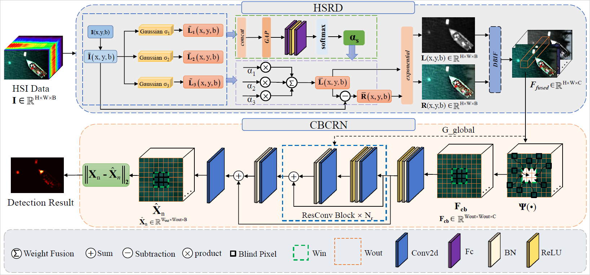

# HRCNet: Retinex-Guided Center-Blind Context Reconstruction Network for Hyperspectral Underwater Target Anomaly Detection

 ## HRCNet Framework

 
 
Hyperspectral anomaly detection (HAD) aims to identify anomalous targets that significantly deviate from the surrounding background. However, existing HAD studies mainly focus on land remote sensing scenes, while datasets for weak underwater anomalous targets in real shallow marine environments remain limited. To address this issue, we construct a hyperspectral underwater anomaly detection dataset for shallow marine target detection. The dataset contains shallow-water scenes with different evaluated water depths and background conditions. In complex underwater environments, water absorption, scattering, and uneven illumination lead to spectral degradation and background interference.  Existing methods suffer from limitations in either background reconstruction or feature representation, for example, reconstruction-based methods are prone to anomaly contamination, while feature learning-based ones often ignore the interaction between illumination and reflectance information. To address these issues, we develop Hyperspectral Retinex Center-Blind Context Reconstruction Network (HRCNet), a hyperspectral underwater anomaly detection framework that consists of Retinex-based dual-branch enhancement and center-blind context reconstruction. Specifically, HRCNet enhances weak anomaly representation through multiscale Retinex decomposition and dual-branch interactive fusion, and constructs a cleaner background representation through a center-blind constraint and context reconstruction. Experimental results show that HRCNet achieves competitive detection performance compared with several state-of-the-art methods under the evaluated nearshore shallow-water and background conditions. These results validate the effectiveness of the proposed framework on the constructed dataset.
This repository is the official implementation of **HRCNet**, a Retinex-guided center-blind context reconstruction network for hyperspectral underwater target anomaly detection.

